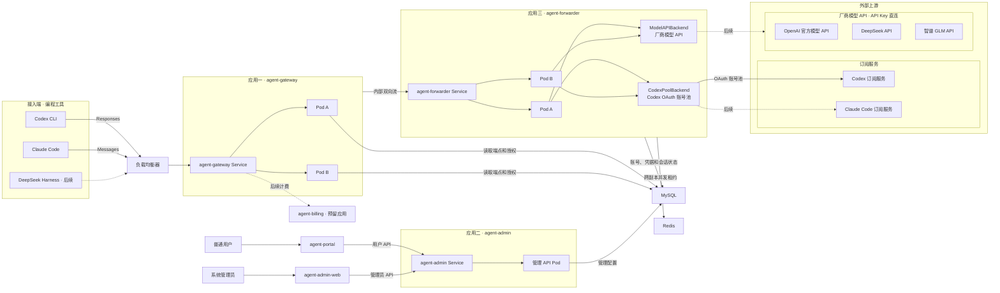
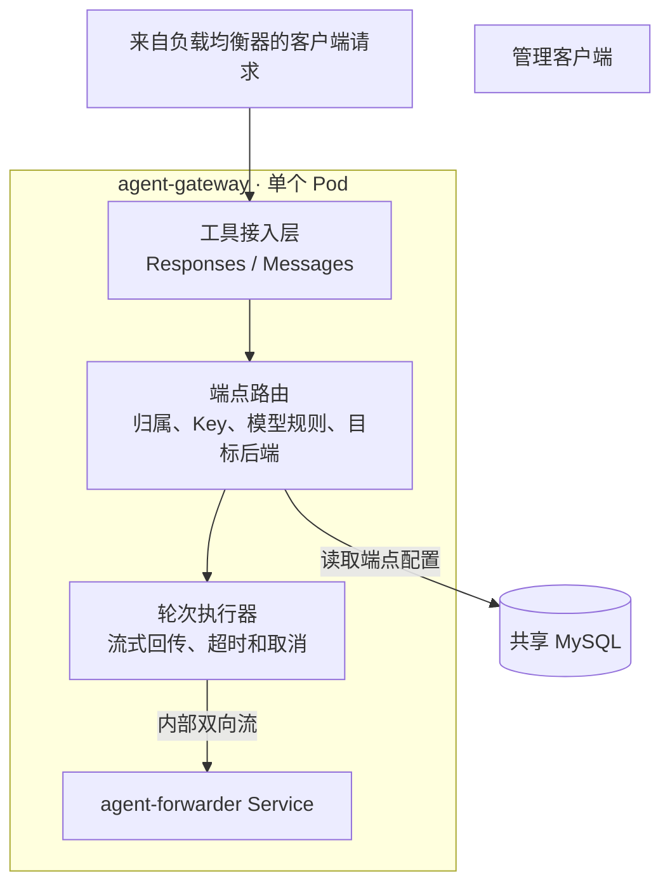
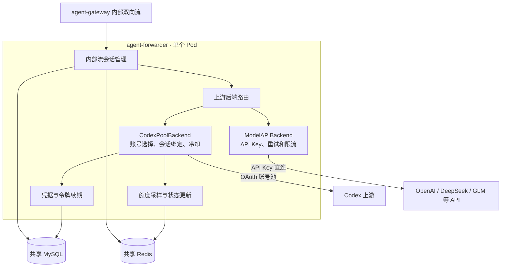
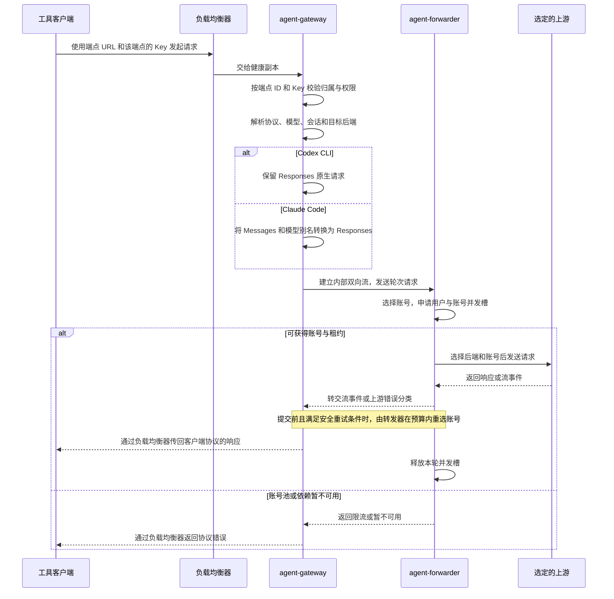

# Agent Proxy 系统架构

状态为设计草案。本文说明服务边界、部署拓扑和请求如何从工具入口到达上游。Codex 的登录、Responses 传输和端点接入方式见 [Codex 接入方式](codex-access.md)。账号选择、额度采样、OAuth 续期和安全换号见 [Codex 账号池化设计](account-pooling.md)。

## 1. 首版范围

| 决策 | 第一版 |
| --- | --- |
| 接入层 | 首版支持 Codex CLI 的 Responses 和 Claude Code 的 Anthropic Messages，先交付 Codex CLI。后续可加入 DeepSeek Harness 等工具的协议适配。 |
| 用户端点 | 一个 Agent Proxy 用户可创建多个接入端点。每个端点配置接入协议、目标上游和模型别名，并单独发放客户端 Key。 |
| 转发后端 | 首版仅启用 Codex OAuth 账号池。Claude Code 请求经协议转换后也进入这个池。 |
| 扩展范围 | 后续接入 Claude Code 订阅账号池，以及 OpenAI、DeepSeek 和智谱 GLM 的模型 API 直连。首版的 Claude Code 模型别名只映射到明确配置的 Codex 模型。 |
| 应用边界 | 管理、接入网关、上游转发和计费是四个独立后端应用。用户控制台与系统管理控制台是两个独立前端应用。各应用分别构建镜像、部署 Deployment、暴露 Service 和扩缩容。 |
| 服务形态 | Go 服务，部署在 Kubernetes。接入网关和上游转发至少运行两个副本，管理和计费按可用性与消费能力独立扩缩。HTTP 使用 `net/http`，内部流式调用使用支持双向流的协议。 |
| 共享状态 | MySQL 保存持久化状态，Redis 协调跨副本并发和缓存。活跃 HTTP 流和 WebSocket 连接由当前实例持有。 |
| 管理 | 用户在 `agent-portal` 注册、登录和管理自己的端点与 Key。管理员在 `agent-admin-web` 管理控制台令牌、上游模型 API Key 和订阅账号。两个前端调用 `agent-admin`，后者验证用户会话或令牌并校验权限。 |

### Go monorepo

每个 Kubernetes 部署单元对应 `apps/<应用名>/` 下的独立 Go 工程。工程拥有自己的 `go.mod`、入口源码、测试、镜像构建文件与 Kustomize 清单。两个控制台各自维护前端资源。根目录 `go.work` 支持联合开发，`deploy/` 组合部署清单。协议与共享基础库在 `shared/` 维护，应用随附编译所需的共享源码，可在关闭 workspace 时构建。跨工程依赖通过部署配置和服务接口连接。迁出方式见 [Monorepo 工程](../README.md#monorepo-工程)。

本轮实施将 `agent-billing` 保留为健康检查占位应用。额度预检、用量事件消费、账单和对账是后续设计，当前推理请求不调用计费应用。

## 2. 架构图

### 2.1 整体系统架构

Kubernetes 独立部署四个后端和两个前端。管理 API 把用户密码的 Argon2id 哈希和有期限的会话摘要存入 MySQL，所有副本共用 Redis 登录与注册限速。浏览器通过 HTTPS Cookie 使用会话。控制台令牌登录继续可用，系统管理控制台使用独立的管理员令牌。`agent-forwarder` 首版启用 Codex OAuth 账号池，预留厂商模型 API 后端。OpenAI 官方模型 API 通过 `api.openai.com` 和 API Key 直接调用 GPT 系列模型。

### 2.2 agent-gateway 单个副本内部架构

图框内的模块随 `agent-gateway` 的每个 Pod 部署。网关不直接保存上游 OAuth 账号，也不直接访问外部模型服务。轮次执行器通过内部双向流调用 `agent-forwarder`，由转发器负责账号池和模型 API。一个用户配置的多个端点由同一个路由模块处理。

### 2.3 agent-forwarder 单个副本内部架构

`agent-forwarder` 是独立 Deployment。CodexPoolBackend 和 ModelAPIBackend 是同一转发应用中的两类后端，后续需要不同扩缩策略时可以拆成两个 Deployment，但不改变网关的内部流接口。账号池内部规则见 [Codex 账号池化设计](account-pooling.md)。

| 应用 | 职责 |
| --- | --- |
| `agent-admin` | 用户、端点、客户端 Key、上游配置、Codex 账号授权和管理操作。写入 MySQL，并发布配置变更。 |
| `agent-gateway` | 工具协议接入、端点鉴权、模型规则、请求预算和内部流转发。 |
| `agent-forwarder` | 统一上游转发入口，内部包含 CodexPoolBackend 和 ModelAPIBackend，负责账号选择、凭据续期、重试、冷却、额度采样和上游错误分类。 |
| `agent-billing` | 首版保留健康检查。后续接收用量事件，处理预检、窗口计数、账单和对账。 |
| `agent-portal` | 用户注册、登录、退出，管理端点、模型映射和上游，签发与轮换端点 Key。 |
| `agent-admin-web` | 用户令牌、Codex OAuth 账号与厂商模型 API Key 的管理界面。 |

`agent-gateway` 到 `agent-forwarder` 使用 gRPC 双向流传递请求、响应事件和轮次结束信号，通过流上下文传播取消。`agent-admin` 写入 MySQL，网关和转发器读取端点版本与权限。后续计费设计采用短时 gRPC 预检与 Redis Stream 用量事件。

| 网关内部模块 | 职责 |
| --- | --- |
| 工具接入层 | 提供各工具所需的 HTTP 和 WebSocket 协议，校验客户端 Key 和模型范围，提取会话信息，转换请求、响应、流事件和错误。 |
| 端点路由 | 用端点 ID 加载用户、接入协议和目标上游的绑定。校验 Key 是否属于该端点，以及用户是否仍有权使用目标上游。 |
| 轮次执行器 | 转发轮次与取消信号，限制请求时间，按客户端协议返回流式错误。 |
| 内部流客户端 | 通过双向流调用 `agent-forwarder`，转发正文、流事件、取消、重试和终止信号。 |

接入协议与后端是两个独立维度。Codex 客户端保留原生字段和事件顺序。Claude Code 的 Messages 入口将受支持的消息、工具调用和工具结果转换为 Codex Responses，再把上游流映射回 Messages SSE。模型别名按端点配置，未配置的模型或无法映射的能力返回对应协议的错误。Claude Code 路径的会话和上下文由该入口适配，共享底层账号池和额度。

调度器接收统一的账号标识、能力、额度和错误分类。OAuth 字段和额度响应头由后端解释，`previous_response_id` 等协议状态由对应适配器处理。首版抽取路由、能力和生命周期的公共契约，具体请求字段仍由所属协议维护。

## 3. 请求流程

图中展示首版的一次推理轮次。工具接入层、端点路由和轮次执行器在 `agent-gateway` 内，账号池和上游协议在 `agent-forwarder` 内。HTTP 每次请求解析端点。WebSocket 建连时选定网关副本，随后每轮重新校验端点配置版本、权限和并发准入。

无效 Key、未授权模型或不支持的协议能力在进入上游之前按客户端协议报错。模型目录和 token 估算是独立入口，也按端点规则处理。流式响应在轮次进行时逐帧返回，结算与释放在正常结束、取消或错误退出时执行。重试、冷却和错误分类的具体条件见 [池化故障切换规则](account-pooling.md#3-会话故障切换与错误语义)。

## 4. 用户端点与接入 API

一个用户可以创建多个同协议或不同协议的端点。每个端点有独立 URL 和客户端 Key，可选择已启用且用户有权访问的一个上游后端。目标可以是订阅账号池，也可以是后续接入的厂商 API 直连配置。管理接口提供查看可选上游、创建和更新端点、停用端点、签发和撤销 Key。所有变更按所属用户校验权限，并记录操作人和更新时间。

| 配置项 | 含义 |
| --- | --- |
| 端点 ID、名称和所属用户 | 全局唯一的端点 ID 用于路由。名称用于管理，用户标识用于权限校验和用量归属。 |
| 接入协议 | 决定客户端可用的路径、传输和响应格式。首版提供 Responses 与 Messages。DeepSeek Harness 的接口以未来兼容测试为准。 |
| 目标后端 | 引用一份受管理的账号池或 API 直连配置。仅在接入协议与目标后端具备所需适配能力时允许启用。 |
| 模型规则 | 决定端点公开的模型、可用能力和显式别名。模型名先在端点内解析。 |
| 访问密钥和状态 | Key 绑定到单个端点，可独立发放和撤销。端点配置与版本保存在 MySQL，副本共享读取。 |

例如，同一个用户可以创建下面的端点。示例中的 ID 用于展示，可替换为实际创建后的值。

| 端点 | 客户端 | 指定上游 | 阶段 |
| --- | --- | --- | --- |
| `ep_codex_pool` | Codex CLI | Codex OAuth 账号池 | 首版 |
| `ep_claude_pool` | Claude Code | Codex OAuth 账号池 | 首版 |
| `ep_codex_openai` | Codex CLI | OpenAI 官方模型 API | 后续，完成 Responses 兼容验证后启用 |
| `ep_deepseek` | DeepSeek Harness | DeepSeek API | 后续，完成工具接口适配后启用 |

请求的 URL 选定端点，端点配置选定上游。请求体的模型和请求头只能在该端点授权范围内影响选路。后端不可用时，故障恢复限于该端点绑定的后端。变更协议、目标后端或模型映射时递增路由版本。已开始的轮次按原版本完成，后续 HTTP 请求读取新配置，旧 WebSocket 在发起下一轮前按协议要求客户端重连。会话绑定和响应索引按端点与路由版本隔离。

### 第一版接口

| 调用方 | 方法与路径 | 用途 |
| --- | --- | --- |
| Codex CLI | `GET /e/{endpoint_id}/v1/models` | 返回该端点允许的模型。 |
| Codex CLI | `POST /e/{endpoint_id}/v1/responses` | Responses 请求，保留 SSE 事件顺序、工具调用字段和终止状态。 |
| Codex CLI | `GET /e/{endpoint_id}/v1/responses` | WebSocket Upgrade，处理连接上的多轮请求、断开和取消。 |
| Codex CLI | `POST /e/{endpoint_id}/v1/responses/compact` | 压缩长会话，优先使用原账号，支持情况按续接和自包含输入分别测试。 |
| Claude Code | `POST /e/{endpoint_id}/v1/messages` | Messages 与流式事件的兼容入口，请求发往配置的 Codex 模型。 |
| Claude Code | `POST /e/{endpoint_id}/v1/messages/count_tokens` | 按映射后的 Codex 请求估算输入 token，由目标客户端的兼容测试确认所需行为。 |
| 运维 | `GET /healthz` 和 `GET /readyz` | 分别报告进程存活和依赖是否已就绪。账号池临时耗尽通过请求错误和指标呈现。 |
| 运维 | `/metrics` 和管理接口 | 使用私有监听器，管理接口独立鉴权。 |

兼容测试固定两个客户端的版本和入口配置。Codex CLI 的基础地址使用 `/e/{endpoint_id}/v1`，Claude Code 使用 `/e/{endpoint_id}` 并由客户端附加 `/v1/messages`。实际支持范围以多轮会话、工具调用、流式错误、取消和上下文压缩行为的验收结果为准。Claude Code 的长会话使用客户端自己的压缩流程。

## 5. Kubernetes 部署与应用边界

| Deployment | 副本与职责 | 对外或内部接口 |
| --- | --- | --- |
| `agent-gateway` | 至少 2 个 Pod，处理 Codex、Claude Code 和后续工具请求。持有客户端连接和内部转发流。 | 通过 Ingress 或 Gateway API 对外。调用 `agent-forwarder` 的集群内 gRPC Service。 |
| `agent-admin` | 至少 2 个 Pod，处理用户、端点、Key、上游配置和账号管理。 | 只通过管理员入口或私有 Service 对外，不接收推理流量。 |
| `agent-forwarder` | 至少 2 个 Pod，处理 CodexPoolBackend 和 ModelAPIBackend。 | 只暴露集群内双向流 Service，不直接对公网开放。 |
| `agent-billing` | 首版运行健康检查占位。 | 集群内 HTTP 健康检查。 |
| `agent-portal` | 用户控制台，转接管理应用的用户 API。 | 用户 Web 入口。 |
| `agent-admin-web` | 系统管理控制台，转接管理应用的管理员 API。 | 受限 Web 入口。 |

所有应用分别构建镜像和发布。外部推理流量由 `agent-gateway` 接收，上游访问由 `agent-forwarder` 发起。转发器通过 Headless Service 发现多个副本，网关的新 gRPC 流在可用副本间分配。

- **入口和流。** Ingress 或 Gateway API 负责 TLS、WebSocket Upgrade、SSE 禁用响应缓冲和连接空闲超时。`agent-gateway` Pod 重启时，客户端连接按协议重连。网关到转发器使用内部双向流，传递请求、流事件、取消、终止和错误分类。
- **健康检查。** 每个 Deployment 提供 `/healthz` 和 `/readyz`。`/readyz` 检查 MySQL、Redis 和必要的内部 Service。`agent-forwarder` 还检查上游凭据存储是否可读取。账号池全部限流时保持进程就绪，按请求返回 `429`。
- **滚动升级。** 使用 Deployment 的 `maxUnavailable: 0` 和 `PodDisruptionBudget`。先从 Service 摘除 Pod，再停止接收新轮次，给 WebSocket 和 SSE 留出排空时间。兼容版本的数据库迁移在应用升级前完成。
- **扩缩容。** `agent-gateway` 按并发连接、首字延迟和 CPU 扩缩。`agent-forwarder` 按上游并发、排队时间和连接数扩缩。`agent-billing` 按 Redis Stream 积压和账单写入延迟扩缩。HPA 不以单一 CPU 指标作为唯一依据。
- **依赖和安全。** MySQL 使用高可用主库或云数据库，Redis 使用支持故障转移的部署。服务间使用 NetworkPolicy、ServiceAccount 和 mTLS 或集群内服务认证。上游凭据使用应用层认证加密，管理入口、内部流和数据库连接都不得记录完整凭据。

用结构化日志关联客户端请求、轮次、网关 Pod、转发 Pod、上游尝试和最终结果。按接入协议、应用和后端监控成功率、首字延迟、排队时间、上游错误分类、换号成功率、刷新失败、计费事件积压和可调度账号数量。指标标签采用低基数维度，详细账号和请求信息由受权限保护的诊断记录查询。

## 6. 实施顺序与系统验收

| 阶段 | 交付与验收 |
| --- | --- |
| 1. 应用骨架 | 创建四个后端、两个前端，以及 Kubernetes 部署和独立的数据库初始化 Job。先打通 MySQL、Redis 和内部认证。 |
| 2. Codex 数据面 | 实现 `agent-gateway` 的端点 Key、Responses HTTP/SSE、模型目录和 compact，以及 `agent-forwarder` 的 CodexPoolBackend。在双副本环境验证内部双向流和配置读取。 |
| 3. 稳定账号池 | 实现跨副本续期与并发租约、WebSocket 多轮、会话绑定、账号级及模型级冷却和安全换号。 |
| 4. Claude Code 接入与首版验收 | 增加 Messages 转换和显式模型别名，用两种客户端在多副本环境完成验收。两个入口共用同一 Codex OAuth 池。 |
| 后续扩展 | 增加 DeepSeek Harness 等接入协议、其他订阅账号池或厂商模型 API。需要独立扩缩时再拆分 `agent-forwarder` 内的后端 Deployment。 |

1. Codex CLI 走真实入口验证多轮 WebSocket、工具调用、compact 和断线重连。HTTP 和 WebSocket 分别验收。
2. Claude Code 验证多轮 Messages SSE、工具调用和结果回传、取消、token 估算及模型别名，确认请求到达 Codex 后端。
3. 用 Kubernetes 多副本验证流量分配、摘流和滚动升级，确认旧连接可以排空，新连接可以进入其他健康副本。
4. 固定两个客户端的版本，分别记录模拟测试和真实账号的受控验收结果。跨副本续期、冷却传播、并发竞争和存储故障使用 [池化验收用例](account-pooling.md#5-池化验收)。
5. 验证同一用户创建多个端点、同协议端点独立选上游、端点 Key 无法跨端点调用。用两个模拟后端验证端点改绑、旧 WebSocket 重连和会话索引隔离。
6. 验证 Redis 故障转移、MySQL 短时不可用、Pod 重启和内部 Service 失败。请求在预算内退出，租约可以回收。
